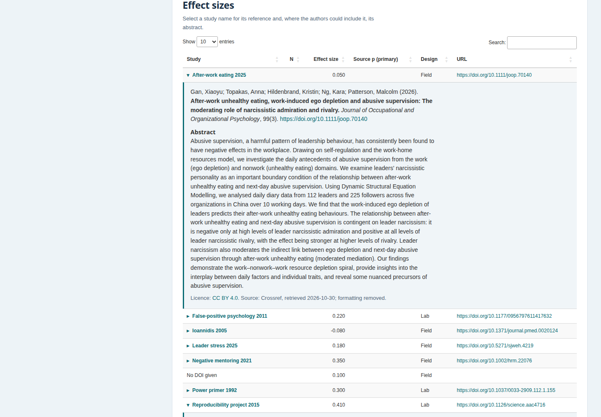
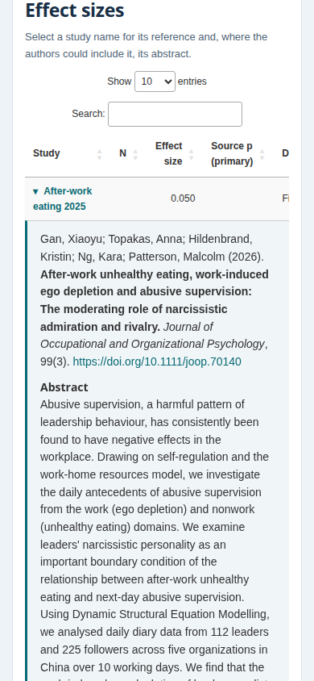

# Study details in generated apps

Readers can open any study in the list of effect sizes to see its APA-style
reference (with a copy button), DOI link and, where permitted, its abstract. Authors supply these details when they
build the app; generated apps never contact external services.

## Design

- **Source.** `fetch_study_metadata()` queries the Crossref REST API at build time,
  once per distinct DOI. When Crossref lacks an abstract or an acceptable licence, it
  asks OpenAlex for the same DOI. Single-work lookups are free on both services
  ([OpenAlex example costs](https://docs.openalex.org/access/example-costs/): "Get
  single entity … Free"; every response in the demo reported a cost of $0). No key is
  needed. Crossref receives an optional `mailto` from `METAUI_MAILTO`, as its
  etiquette asks. An optional `OPENALEX_API_KEY` raises OpenAlex's rate limit from 10
  to 30 requests per second
  ([OpenAlex authentication](https://docs.openalex.org/how-to-use-the-api/rate-limits-and-authentication)).
  It is sent as a bearer header and never stored. No package dependency is added
  (base `utils::download.file()` plus `jsonlite`). Results can be cached in an
  editable CSV. Missing, malformed, unknown (HTTP 404), unreachable and conflicting
  DOIs are reported by status. They receive no metadata, and nothing is matched by
  title. Authors can also write the CSV themselves. In a schema version 2
  configuration, `study_info: {"cache": "study-metadata.csv"}` makes `build_app()`
  run the lookup into that CSV; found DOIs are reused on rebuilds.
- **Abstracts.** Crossref states that its metadata is mostly CC0 facts, "with the
  exception of abstracts which are subject to publisher or author copyright"
  ([Crossref, retrieving metadata](https://www.crossref.org/documentation/retrieve-metadata/)).
  The Initiative for Open Abstracts says third parties may not republish an abstract
  "unless the license under which it is originally published permits such
  republication" ([I4OA](https://i4oa.org/)). OpenAlex does not ship plain-text
  abstracts "for legal reasons", only a word index
  ([OpenAlex work attributes](https://help.openalex.org/data/works/attributes/)).
  An abstract is therefore kept when the article is published under a Creative
  Commons licence (CC BY, with or without SA, ND or NC terms), CC0 or the Public
  Domain Mark. The licence comes from Crossref (version
  of record or unspecified, already started) or, failing that, from an OpenAlex
  location for the published version. ND licences qualify: CC BY-ND 4.0 grants the
  right to "reproduce and Share the Licensed Material, in whole or in part", and
  only prohibits sharing Adapted Material
  ([legal code](https://creativecommons.org/licenses/by-nd/4.0/legalcode.en)).
  Creative Commons adds that an unaltered excerpt is generally not an adaptation
  ([FAQ](https://creativecommons.org/faq/#can-i-reuse-an-excerpt-of-a-larger-work-that-is-licensed-with-the-noderivs-restriction)).
  Removing markup is a technical modification that "never produces Adapted
  Material" (section 2(a)(4)). NonCommercial licences permit use "not primarily
  intended for or directed towards commercial advantage or monetary compensation"
  ([BY-NC 4.0 legal code](https://creativecommons.org/licenses/by-nc/4.0/legalcode.en)),
  which covers academic apps; authors of a commercial app opt out with
  `abstracts = "exclude_nc"`. `abstracts = "all"` keeps every abstract found, and the app
  then attributes the inclusion to the app authors. The app shows the licence and
  source beside each abstract and notes that formatting was removed; otherwise it
  says "No openly licensed abstract found." This is a design rule, not legal advice.
  No source states outright that an article's CC licence covers its abstract, and
  neither Crossref nor OpenAlex verifies deposited licence values.
- **Display.** Each study with details becomes a native `<button>` in the Study
  column, with `aria-expanded`, a ▸/▾ marker matching the app's other disclosures
  and a one-line reference as its hover title. Activating it with a pointer, Enter
  or Space opens a DataTables child row under the effect. On wide screens the text
  is capped at 75 characters per line; on narrow screens it wraps to the visible
  table width and stays visible while the table scrolls sideways. A button after
  the reference copies it as rich text (italics, link) with a plain-text
  alternative. It uses the copy event, which also works on plain-HTTP deployments,
  and announces "Reference copied" in a status region. Studies without
  details keep plain, escaped labels. All values are escaped when the app is built.

## Checks

- `tests/testthat/test-study-info.R` uses Crossref-shaped responses with no network
  access. It covers parsing, the licence rule, statuses, cache reuse, escaping,
  storage, removal on rebuild and `build_app()` schema-version handling. The full
  suite passes, and the template-sync test covers the new helpers.
- `demo-build.R` builds synthetic effects for ten studies, eight with real DOIs.
  A live lookup on 2026-10-30 matched 8 of 10 studies and kept five abstracts. Three
  had CC BY abstracts and licences in Crossref. For Ioannidis (2005), Crossref had
  the CC BY licence but no abstract, so the abstract came from OpenAlex. For the
  Scandinavian Journal of Work, Environment & Health article, Crossref had the
  abstract but no licence, and OpenAlex recorded CC BY. Science and Psychological
  Science had no open licence in either source, and the APA article had none either.
  One unregistered DOI was reported as `not_found`, and the row without a DOI as
  `no_doi`.
- `browser-check.cjs` drives that app in Chromium at 1440×1000 and 390×844. It opens
  a study by keyboard (Enter) and closes it with Space, checks `aria-expanded`,
  copies the reference by keyboard and checks the copied plain text and HTML,
  confirms that the toggle does not select the table row, and saves these
  screenshots. No page errors occurred. The existing `tools/browser-smoke.cjs`
  also passes on an app without study details.
